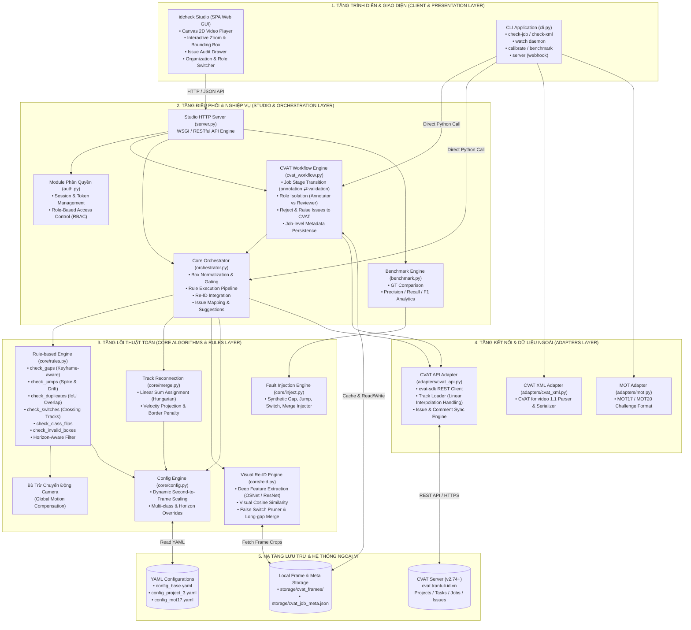
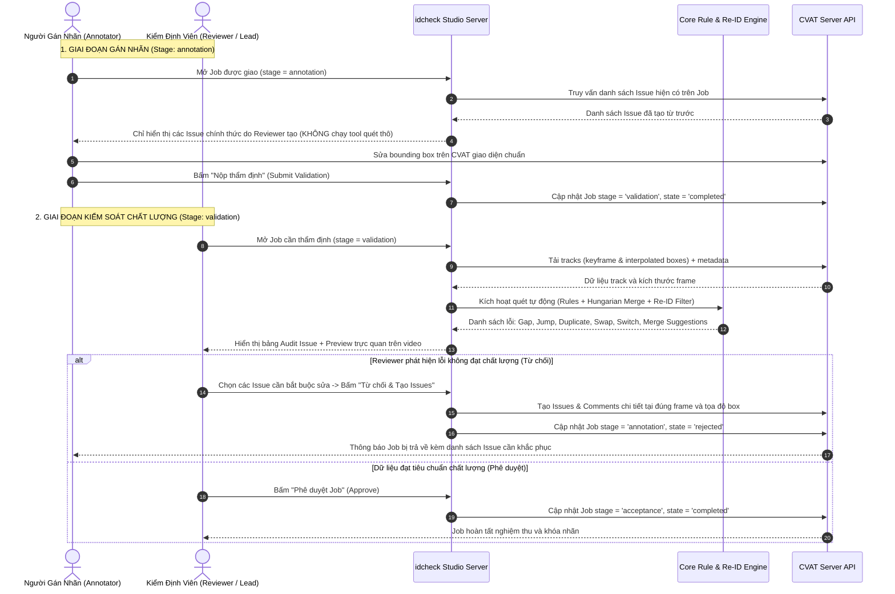
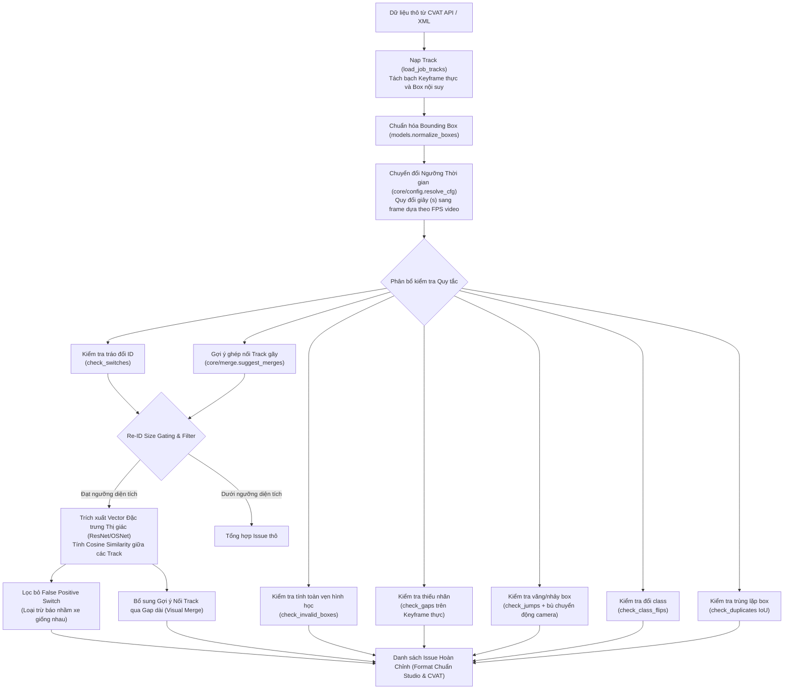
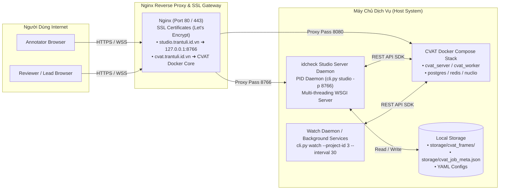

# KIẾN TRÚC HỆ THỐNG IDCHECK (SYSTEM ARCHITECTURE)

> **Dự án**: `idcheck` — Automated Quality Assurance & Verification System for Multi-Object Tracking (MOT) on CVAT  
> **Phiên bản**: 2.0 (Hỗ trợ Dashcam BDD100K, Re-ID Deep Feature, Role-Based Access Control)  
> **Tác giả**: Tran Tuan Kinh  
> **Ngày cập nhật**: 18/10/2026

---

## 1. Tổng Quan Kiến Trúc (System Overview)

Hệ thống **`idcheck`** là nền tảng kiểm thử và đảm bảo chất lượng tự động (QA/QC) chuyên dụng cho dữ liệu gán nhãn theo dõi đa đối tượng (Multi-Object Tracking - MOT). Hệ thống được thiết kế theo mô hình kiến trúc nhiều tầng (Layered Architecture) với độ ghép nối lỏng (Loose Coupling), phục vụ hai phương thức vận hành chính:

1. **Vận hành Ngoại tuyến & Tự động (Offline & Automated Daemons)**: Quét file XML, chạy daemon giám sát liên tục (`watch`) qua CVAT REST API, tự động tinh chỉnh ngưỡng (`calibrate`), chẩn đoán chuyên sâu (`diagnose`).
2. **Nền tảng Tương tác Trực tuyến (Interactive Web Studio)**: Web Studio tương tác thời gian thực, hỗ trợ phân quyền vai trò (Annotator, Reviewer, Lead/Admin), trực quan hóa bounding box, phát hiện lỗi tự động và đồng bộ hai chiều với CVAT server.

---

## 2. Sơ Đồ Kiến Trúc Tổng Thể (System Architecture Diagram)

Dưới đây là sơ đồ kiến trúc thể hiện toàn bộ các tầng logic, thành phần module và tương tác dữ liệu trong hệ thống `idcheck`:

---

## 3. Kiến Trúc Luồng Dữ Liệu & Nghiệp Vụ (Data Flow Architecture)

### 3.1. Quy Trình Phân Vai & Kiểm Thẩm Định Chất Lượng (QC Workflow)

Hệ thống phân tách nghiêm ngặt không gian làm việc giữa **Annotator** (người gán nhãn) và **Reviewer** (người duyệt/kiểm soát chất lượng):

---

### 3.2. Đường Ống Xử Lý Lỗi (Core Detection Pipeline)

Đường ống xử lý dữ liệu từ CVAT đến khi sinh ra danh sách lỗi hoàn chỉnh:

---

## 4. Đặc Tả Từng Thành Phần Hệ Thống (Component Specifications)

| Tầng (Layer) | Module / Tệp Nguồn | Vai Trò & Nhiệm Vụ Kỹ Thuật | Phụ Thuộc (Dependencies) |
|---|---|---|---|
| **Presentation** | [`studio/static/index.html`](file:///home/tran-tuan-kinh/idcheck/studio/static/index.html) [`studio/static/app.js`](file:///home/tran-tuan-kinh/idcheck/studio/static/app.js) [`studio/static/style.css`](file:///home/tran-tuan-kinh/idcheck/studio/static/style.css) | Giao diện SPA hiện đại, Dark-mode glassmorphic, tương tác canvas vẽ bounding box, scrubber timeline video, bảng phân tích issue, điều khiển zoom-to-box mượt mà. | HTML5 Canvas, Vanilla JS/CSS |
| **Presentation** | [`cli.py`](file:///home/tran-tuan-kinh/idcheck/cli.py) | CLI entrypoint cung cấp các subcommand: `check-job`, `check-xml`, `watch`, `calibrate`, `server`, `studio`, `benchmark`. | `argparse`, `core.*`, `adapters.*` |
| **Orchestration** | [`studio/server.py`](file:///home/tran-tuan-kinh/idcheck/studio/server.py) | Máy chủ HTTP REST API, định tuyến các endpoint xác thực, danh sách job, nạp frame media, quét lỗi và nhận lệnh kiểm duyệt. | `http.server`, `urllib` |
| **Orchestration** | [`studio/backend/auth.py`](file:///home/tran-tuan-kinh/idcheck/studio/backend/auth.py) | Quản lý phiên đăng nhập (Session Token), xác thực với CVAT API, RBAC (Admin, Annotator, Reviewer). | `hashlib`, `secrets`, `time` |
| **Orchestration** | [`studio/backend/cvat_workflow.py`](file:///home/tran-tuan-kinh/idcheck/studio/backend/cvat_workflow.py) | Cầu nối nghiệp vụ với CVAT: Tải job, nạp frame cache, phân định quyền truy cập ở mức Job, thực thi tạo Issue/Comment trực tiếp trên CVAT khi từ chối, chuyển đổi stage. | `adapters.cvat_api`, `core.config` |
| **Orchestration** | [`studio/backend/orchestrator.py`](file:///home/tran-tuan-kinh/idcheck/studio/backend/orchestrator.py) | Điều phối chu trình quét: Chuẩn hóa dữ liệu box, nạp cấu hình YAML phù hợp FPS, gọi thuật toán lõi, tích hợp trích xuất Re-ID và ánh xạ sang định dạng Issue của Studio. | `core.rules`, `core.merge`, `core.reid` |
| **Core Algorithm** | [`core/rules.py`](file:///home/tran-tuan-kinh/idcheck/core/rules.py) | Thực thi 6 quy tắc hình học - động học cơ bản: Keyframe-aware gap detection, camera motion compensation, jump spike/drift detection, class flips, duplicates, horizon-aware small box filter. | `math`, `statistics`, `collections` |
| **Core Algorithm** | [`core/merge.py`](file:///home/tran-tuan-kinh/idcheck/core/merge.py) | Thuật toán ghép nối track (Track Reconnection): Dự đoán quỹ đạo tuyến tính, phạt đối tượng ra/vào mép màn hình (`border_penalty`), giải bài toán gán cặp tối ưu bằng thuật toán Hungarian. | `scipy.optimize.linear_sum_assignment`, `numpy` |
| **Core Algorithm** | [`core/reid.py`](file:///home/tran-tuan-kinh/idcheck/core/reid.py) | Trích xuất vector đặc trưng ngoại hình sâu (Deep Visual Embeddings), tính độ tương đồng Cosine, lọc bỏ false positive switch và tìm kiếm mối nối track qua khoảng ngắt quãng dài. | `cv2`, `numpy`, `torch` / TorchVision |
| **Core Algorithm** | [`core/config.py`](file:///home/tran-tuan-kinh/idcheck/core/config.py) | Bộ chuẩn hóa và chuyển đổi cấu hình theo giây (`_s`) sang số frame tương ứng theo FPS thực tế của từng video chuỗi. | `copy` |
| **Core Algorithm** | [`core/inject.py`](file:///home/tran-tuan-kinh/idcheck/core/inject.py) | Engine tiêm lỗi giả lập (Synthetic Fault Injection) phục vụ tạo bộ dữ liệu Ground Truth kiểm thử và benchmark. | `random`, `copy` |
| **Adapters** | [`adapters/cvat_api.py`](file:///home/tran-tuan-kinh/idcheck/adapters/cvat_api.py) | Giao tiếp với CVAT REST API thông qua `cvat-sdk`: Tải track có xử lý cờ nội suy, tải ảnh frame, tạo issue/comment, cập nhật metadata job. | `cvat-sdk`, `requests` |
| **Adapters** | [`adapters/cvat_xml.py`](file:///home/tran-tuan-kinh/idcheck/adapters/cvat_xml.py) | Đọc và ghi file định dạng `CVAT for video 1.1 XML` cho chế độ làm việc offline không cần mạng. | `xml.etree.ElementTree` |

---

## 5. Kiến Trúc Triển Khai & Vận Hành Hạ Tầng (Deployment Architecture)

Hệ thống được cấu hình triển khai trên nền tảng Linux Server:

### Các thông số hạ tầng:
- **Tên miền Studio**: `https://studio.trantuli.id.vn`
- **Tên miền CVAT**: `https://cvat.trantuli.id.vn`
- **Cổng nội bộ Studio**: `8766`
- **Quản lý tiến trình nền**: Được giám sát qua Background Process / Systemd Service, đảm bảo tự động phục hồi khi gặp sự cố.
