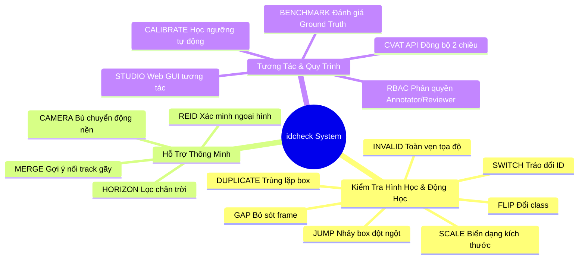
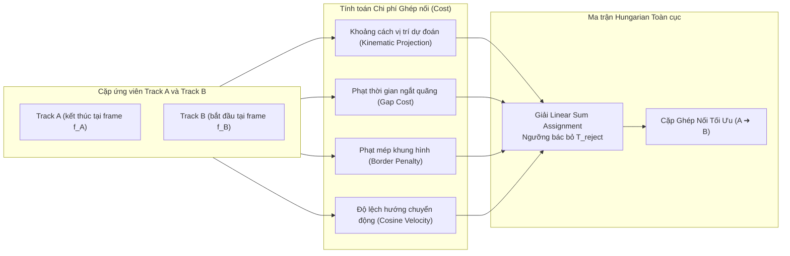

# ĐẶC TẢ YÊU CẦU & THIẾT KẾ HỆ THỐNG IDCHECK (SPECIFICATIONS & TECHNICAL DESIGN)

> **Dự án**: `idcheck` — Automated Quality Assurance & Verification System for Multi-Object Tracking (MOT) on CVAT  
> **Tài liệu**: Software Requirements Specification (SRS) & Detailed Design Document (DDD)  
> **Phiên bản**: 2.0  
> **Ngày cập nhật**: 18/10/2026

---

## 1. Giới Thiệu & Mục Tiêu Hệ Thống

### 1.1. Bối cảnh
Trong các dự án thị giác máy tính cho xe tự hành (Autonomous Driving) và giám sát thông minh (Smart City/Surveillance), dữ liệu gán nhãn theo dõi đa đối tượng (Multi-Object Tracking - MOT) đóng vai trò sống còn. Tuy nhiên, quá trình gán nhãn thủ công trên các công cụ như CVAT thường xuyên gặp phải các sai sót phổ biến của con người:
- Bỏ sót đối tượng trong một vài frame giữa chừng (Gap).
- Bounding box bị văng, giật cục hoặc lệch tọa độ (Jump).
- Tráo đổi ID giữa các đối tượng khi đi ngang qua nhau (ID Switch).
- Tạo 2 track đè lên cùng 1 đối tượng thực tế (Duplicate).
- Đứt gãy 1 đối tượng thành nhiều ID khác nhau (Broken/Fragmented Tracks).
- Nhập sai class giữa các frame (Class Flip) hoặc box bị bẹp, văng ra ngoài khung hình (Invalid Box).

### 1.2. Mục tiêu kỹ thuật
`idcheck` được thiết kế nhằm:
1. **Tự động hóa hoàn toàn** khâu kiểm thử chất lượng nhãn MOT, thay thế việc kiểm tra thủ công từng frame vốn tốn kém thời gian và dễ bỏ sót.
2. **Tích hợp sâu với CVAT**: Kết nối trực tiếp qua CVAT REST API, hỗ trợ quy trình phân quyền chuẩn (Annotator sửa nhãn, Reviewer thẩm định chất lượng và đóng dấu lỗi trực tiếp lên CVAT).
3. **Thích ứng thông minh với video thực tế**: Tự động bù trừ rung lắc và chuyển động của xe gắn camera hành trình (`compensate_camera`), lọc nhiễu các xe siêu nhỏ ở dải chân trời (`horizon_filter`), và ứng dụng mô hình Deep Re-ID để xác minh ngoại hình trực quan.
4. **Độc lập tốc độ khung hình (FPS Agnostic)**: Toàn bộ cấu hình hệ thống được định nghĩa theo thang thời gian thực (giây), tự động co giãn theo FPS của từng tập dữ liệu (5 FPS, 10 FPS, 30 FPS...).

---

## 2. Đặc Tả Yêu Cầu Chức Năng (Functional Requirements)



### FR-01: Phát hiện Bỏ sót Frame (`GAP`)
- **Mô tả**: Phát hiện các khoảng trống thời gian mà một đối tượng đang di chuyển bình thường nhưng bị biến mất một vài frame rồi xuất hiện lại với cùng ID.
- **Xử lý Bounding Box Nội suy của CVAT**: Khi track được nạp với cờ `interpolate=True`, hệ thống kiểm tra và chỉ tính toán gap dựa trên các **Keyframe thực tế** mà người gán nhãn đã đặt, ngăn chặn việc CVAT tự động bù box làm ẩn đi lỗi bỏ sót.
- **Điều kiện vi phạm**: Khoảng frame thiếu $missing = f_{next} - f_{prev} - 1$ thỏa mãn:
  $$min\_missing\_gap \le missing \le max\_missing\_gap$$
- **Ngoại lệ (Gating)**:
  - Bỏ qua nếu người gán nhãn đã chủ động đánh dấu `outside=True` trong khoảng cách này.
  - Bỏ qua nếu có cờ `skip_occluded_gap=True` và box trước hoặc sau bị che khuất (`occluded=True`).

### FR-02: Phát hiện Nhảy Box Bất Thường (`JUMP`)
- **Mô tả**: Phát hiện trường hợp box di chuyển với vận tốc hoặc gia tốc phi thực tế.
- **Phân loại**:
  - **Spike**: Box nhảy vọt đi một vị trí xa trong 1 frame rồi lập tức quay về quỹ đạo cũ ở frame kế tiếp.
  - **Drift**: Vị trí box bị dịch chuyển một bước quá lớn so với vận tốc tối đa cho phép của phương tiện/người đi bộ.
- **Bù trừ chuyển động camera (`compensate_camera`)**: Tính toán vector dịch chuyển trung vị (Median Motion Vector) của toàn bộ các track khác trong cùng frame để trừ đi vận tốc trôi nền của xe gắn camera.
- **Lọc trôi đều mép khung hình (`is_smooth_drift`)**: Không báo lỗi khi một xe lạ di chuyển ổn định từ ngoài viền màn hình vào trong khung hình.

### FR-03: Phát hiện Biến thiên Kích thước (`SCALE`)
- **Mô tả**: Phát hiện bounding box bị co rút hoặc phình to bất thường giữa 2 frame liên tiếp:
  $$ratio = \frac{\max(size_{next}, size_{prev})}{\min(size_{next}, size_{prev})} > max\_scale$$
- **Ngoại lệ**: Tự động bỏ qua nếu box được đánh dấu `occluded=True` (khi xe bị che khuất một phần bởi cột đèn, cây cối hoặc phương tiện khác).

### FR-04: Phát hiện Tráo đổi ID (`SWITCH / Swap`)
- **Mô tả**: Phát hiện trường hợp hai track $A$ và $B$ giao cắt hoặc đi gần nhau và bị hoán đổi ID cho nhau.
- **Điều kiện kích hoạt**:
  1. Khoảng cách giữa 2 tâm box $dist(A, B) \le swap\_max\_sep \times \min(size_A, size_B)$.
  2. Hai quỹ đạo cắt chéo nhau (Cross trajectory) hoặc có bước nhảy vận tốc tương quan nghịch.
- **Bảo vệ bằng Re-ID (Re-ID Verification)**: Sử dụng mô hình Deep Re-ID để so sánh độ tương đồng ngoại hình trước và sau giao cắt. Nếu việc giữ nguyên ID có độ tương đồng ngoại hình cao hơn việc tráo đổi ID, hệ thống tự động loại bỏ cảnh báo giả (Pruning False Positive).

### FR-05: Phát hiện Trùng Lặp Nhãn (`DUPLICATE`)
- **Mô tả**: Phát hiện 2 track khác nhau nhưng bị vẽ đè lên cùng một đối tượng vật lý.
- **Điều kiện vi phạm**: Chỉ số IoU (Intersection over Union) giữa 2 box vượt ngưỡng `dup_iou` (mặc định 0.7) liên tục trong ít nhất `dup_min_frames` khung hình.

### FR-06: Kiểm tra Tính Toàn Vẹn Hình Học (`INVALID_BOX`)
- **Mô tả**: Phát hiện các box lỗi do thao tác vẽ sai của công cụ hoặc annotator:
  - Chiều rộng $w \le 0$ hoặc chiều cao $h \le 0$ (box bị bẹp hoặc kéo ngược tọa độ).
  - Box nằm hoàn toàn ra ngoài phạm vi khung hình ($x_2 \le 0$, $y_2 \le 0$, $x_1 \ge W$, $y_1 \ge H$).

### FR-07: Đổi Nhãn Đối Tượng (`CLASS_FLIP`)
- **Mô tả**: Trong cùng một track ID, đối tượng bị thay đổi nhãn phân loại giữa các frame (ví dụ: đang là `car` tự nhiên chuyển sang `truck` hoặc `bus`).

### FR-08: Gợi Ý Ghép Nối Track Bị Đứt Gãy (`MERGE SUGGESTION`)
- **Mô tả**: Tự động tìm kiếm và gợi ý ghép nối 2 track độc lập $A$ (kết thúc tại frame $f_A$) và $B$ (bắt đầu tại frame $f_B$) thành 1 track duy nhất:
  - Cùng class đối tượng.
  - Khoảng ngắt quãng $1 \le f_B - f_A \le max\_merge\_gap$.
  - Tỷ lệ kích thước $\frac{1}{max\_merge\_scale} < \frac{size(B_{start})}{size(A_{end})} < max\_merge\_scale$.
  - Đạt điều kiện tối ưu bài toán gán cặp toàn cục Hungarian matching.
  - Phạt điểm mép biên (`border_penalty`): Tránh ghép nhầm một xe vừa đi khuất ở mép trái với một xe mới xuất hiện ở mép trái.

### FR-09: Bộ Lọc Dải Chân Trời Xe Tự Hành (`HORIZON_FILTER`)
- **Mô tả**: Với video camera hành trình, các xe ở dải chân trời (vanishing point) có kích thước rất nhỏ và thường xuyên chập chờn do giới hạn phân giải của camera.
- **Quy tắc**: Nếu box nằm trong dải chân trời $Y \in [0.32 \times H, 0.54 \times H]$ và có kích thước dưới ngưỡng tối thiểu ($w < 18$ px, $h < 20$ px hoặc diện tích $< 360$ px$^2$), hệ thống sẽ tự động miễn trừ các cảnh báo rung giật/gap nhỏ để tránh làm loãng danh sách lỗi của annotator.

### FR-10: Tự Động Tinh Chỉnh Ngưỡng Thống Kê (`CALIBRATE`)
- **Mô tả**: Hệ thống cung cấp lệnh `cli.py calibrate` và API `/api/cvat/calibrate` để học các ngưỡng vật lý từ các Job đã được nghiệm thu (Ground Truth).
- **Thuật toán**: Tính toán phân vị phân phối (Percentile 99th, 99.5th) của vận tốc, tỷ lệ scale và bước nhảy để tạo ra file cấu hình tối ưu cho từng dự án mà không cần căn chỉnh thủ công bằng phỏng đoán.

### FR-11: Phân Quyền Vai Trò Người Dùng (RBAC)
- **Cơ chế**: Hệ thống hỗ trợ 3 vai trò chính:
  1. **Admin / Project Lead**: Toàn quyền xem, cấu hình, gán người dùng, chạy benchmark và hiệu chuẩn ngưỡng.
  2. **Reviewer (Kiểm soát viên)**: Chạy công cụ quét lỗi tự động, xem preview, thẩm định lỗi, phê duyệt nghiệm thu (`approve`) hoặc từ chối và đẩy Issue trực tiếp lên CVAT (`reject_and_raise_issues`).
  3. **Annotator (Người gán nhãn)**: Không chạy tool quét thô; giao diện chỉ hiển thị đúng các Issue do Reviewer phê chuẩn và giao việc từ CVAT. Được phép cập nhật trạng thái đã sửa và bấm "Nộp thẩm định".

### FR-12: Tương Tác Hai Chiều với CVAT API
- **Mô tả**: Khi Reviewer bấm "Từ chối & Đẩy Issue":
  - Hệ thống tự động gọi `cvat-sdk` tạo các đối tượng Issue và Comment trên đúng vị trí frame và tọa độ bounding box tương ứng.
  - Tự động chuyển `stage = 'annotation'` và `state = 'rejected'`.
  - Khi Reviewer phê duyệt, hệ thống chuyển `stage = 'acceptance'` và `state = 'completed'`.

---

## 3. Đặc Tả Yêu Cầu Phi Chức Năng (Non-Functional Requirements)

| Tiêu Chí | Yêu Cầu Kỹ Thuật Chi Tiết |
|---|---|
| **NFR-01: Hiệu Năng & Độ Trễ** | - Tốc độ quét thuật toán hình học đạt $\ge 1500$ frame/giây trên CPU tiêu chuẩn.<br/>- Toàn bộ chu trình quét 1 job (300 frame, ~150 track) kèm kiểm tra Re-ID hoàn tất trong $\le 2.0$ giây.<br/>- Bộ nhớ đệm frame media (`storage/cvat_frames/`) đảm bảo độ trễ tải ảnh $\le 50$ ms. |
| **NFR-02: Tính Chính Xác (Accuracy)** | - Tỷ lệ phát hiện lỗi (Recall) đạt $\ge 95\%$ trên các lỗi tiêm giả lập (Synthetic Injected GT).<br/>- Tỷ lệ báo nhầm (False Positive Rate) trên các job chuẩn $\le 5\%$ sau khi áp dụng Re-ID và Horizon filter. |
| **NFR-03: Tính Thích Ứng FPS** | - Hệ thống tự động quy đổi toàn bộ các tham số thời gian (`_s`) sang số frame chính xác theo công thức $N = \text{round}(T \times FPS)$ qua hàm `resolve_cfg()`. |
| **NFR-04: Khả Năng Mở Rộng (Scalability)** | - Kiến trúc modular cho phép bổ sung thêm quy tắc mới trong `core/rules.py` mà không ảnh hưởng tới workflow của Studio và CVAT.<br/>- Hỗ trợ đa tổ chức (Multi-tenant Organization) trên CVAT. |
| **NFR-05: Bảo Mật (Security)** | - Xác thực bằng CVAT Session Token kết hợp Token xác thực nội bộ của Studio.<br/>- Tách biệt phiên đăng nhập, phân quyền ở mức Job không cho phép Annotator can thiệp vào quyền review của người khác. |
| **NFR-06: Trải Nghiệm Người Dùng (UX)** | - Giao diện Web SPA tương tác thời gian thực, hỗ trợ phím tắt điều hướng nhanh (`Space` phát/dừng, `A`/`D` lùi/tiến frame, `Z` zoom bám box lỗi). |

---

## 4. Thiết Kế Thuật Toán Lõi (Detailed Algorithm Design)

### 4.1. Thuật Toán Ghép Nối Track Toàn Cục (Hungarian Merge Matching)

Bài toán ghép nối track được mô hình hóa dưới dạng bài toán gán cặp tối ưu hai phía (Bipartite Matching). Với tập track kết thúc sớm $\mathcal{A}$ và tập track bắt đầu muộn $\mathcal{B}$, ma trận chi phí $C_{i,j}$ được xây dựng như sau:

$$C_{i,j} = g(A_i, B_j) + \lambda_{gap} \times (f_{start}(B_j) - f_{end}(A_i))$$

Trong đó:
- $g(A_i, B_j) = \frac{\|\mathbf{p}_{pred}(A_i, \Delta f) - \mathbf{c}(B_j)\|}{\max(w_A, h_A)}$: Khoảng cách Euclidean chuẩn hóa giữa vị trí dự đoán từ vận tốc của $A_i$ và vị trí thực tế của $B_j$.
- Nếu cả $A_i$ và $B_j$ đều nằm gần mép khung hình và di chuyển cùng chiều ra mép:
  $$C_{i,j} \leftarrow C_{i,j} + \text{border\_penalty}$$
- Nếu hướng di chuyển của 2 track lệch nhau (góc $\theta$ giữa hai vector vận tốc):
  $$C_{i,j} \leftarrow C_{i,j} + w_{dir} \times \frac{1 - \cos\theta}{2}$$

Để xử lý trường hợp track không có đối tác ghép nối, ta mở rộng ma trận $C$ kích thước $2N \times 2N$ với ngưỡng bác bỏ $T_{reject} = 0.5 \times merge\_max\_cost$:

$$\mathbf{M} = \begin{bmatrix} \mathbf{C}_{N \times N} & \mathbf{T}_{reject} \\ \mathbf{T}_{reject} & \mathbf{0} \end{bmatrix}$$

Nghiệm tối ưu được giải chính xác bằng hàm `scipy.optimize.linear_sum_assignment(M)`.



---

### 4.2. Thuật Toán Bù Trừ Chuyển Động Camera (Camera Motion Compensation)

Khi camera hành trình di chuyển, toàn bộ các đối tượng trong ảnh đều bị dời đi một khoảng do chuyển động của chính xe gắn camera. Để không báo nhầm lỗi `JUMP` khi xe rẽ gấp hoặc phanh gấp:

1. Xây dựng chỉ mục tâm box tại frame $a$ và frame $b$:
   $$\mathcal{I}(f) = \{ track\_id: (c_x, c_y) \}$$
2. Với đối tượng đang xét $t_0$, tìm tập các đối tượng khác cùng xuất hiện ở cả 2 frame:
   $$\mathcal{S} = \{ t \in \mathcal{I}(a) \cap \mathcal{I}(b) \mid t \neq t_0 \}$$
3. Nếu $|\mathcal{S}| \ge cam\_min\_tracks$ (mặc định 4 track):
   $$\mathbf{v}_{cam} = \left( \text{median}_{t \in \mathcal{S}} (x_{b}^t - x_{a}^t), \; \text{median}_{t \in \mathcal{S}} (y_{b}^t - y_{a}^t) \right)$$
4. Độ dịch chuyển tương đối thực tế của đối tượng $t_0$:
   $$\mathbf{v}_{rel}(t_0) = (x_b^{t_0} - x_a^{t_0}, y_b^{t_0} - y_a^{t_0}) - \mathbf{v}_{cam}$$
5. Vận tốc kiểm tra ngưỡng:
   $$v = \frac{\|\mathbf{v}_{rel}(t_0)\|}{\Delta t \times size(t_0)}$$

---

### 4.3. Xác Minh Đặc Trưng Ngoại Hình Sâu (Deep Visual Re-ID)

Để loại trừ các cảnh báo nhầm và tìm thêm các mối nối qua khoảng thời gian dài:
1. **Trích xuất Bounding Box Crop**: Cắt ảnh phương tiện từ frame cache, chuẩn hóa về kích thước $128 \times 128$.
2. **Deep Feature Extractor**: Sử dụng mạng CNN trích xuất vector đặc trưng $\mathbf{e} \in \mathbb{R}^{512}$ có chuẩn $\|\mathbf{e}\| = 1$.
3. **Cosine Similarity**:
   $$\text{Sim}(A, B) = \mathbf{e}_A \cdot \mathbf{e}_B$$
4. **Loại trừ Switch Sai (False Switch Pruning)**:
   - Khi phát hiện hoán đổi giữa track $A$ và $B$ tại frame $f$:
   - Tính $\text{Sim}_{keep} = \text{Sim}(A_{pre}, A_{post}) + \text{Sim}(B_{pre}, B_{post})$
   - Tính $\text{Sim}_{swap} = \text{Sim}(A_{pre}, B_{post}) + \text{Sim}(B_{pre}, A_{post})$
   - Nếu $\text{Sim}_{keep} > \text{Sim}_{swap} + \delta$, hủy bỏ cảnh báo Switch vì ngoại hình thực tế không hề bị đổi.

---

## 5. Thiết Kế Mô Hình Dữ Liệu (Data Models & Schemas)

### 5.1. Mô Hình Lõi (Core Schema)

```python
class Box:
    frame: int          # Số thứ tự khung hình
    x1: float          # Tọa độ góc trên bên trái x
    y1: float          # Tọa độ góc trên bên trái y
    x2: float          # Tọa độ góc dưới bên phải x
    y2: float          # Tọa độ góc dưới bên phải y
    label: str         # Nhãn đối tượng ('car', 'pedestrian'...)
    outside: bool      # True nếu box ra ngoài khung hình
    occluded: bool     # True nếu box bị che khuất một phần
    keyframe: bool     # True nếu là keyframe thực, False nếu là box nội suy

class Track:
    id: int             # Mã định danh đối tượng
    label: str          # Nhãn đối tượng
    boxes: dict[int, Box] # Ánh xạ frame_id -> Box
    attributes: list    # Thuộc tính mở rộng

class Issue:
    id: str             # Mã định danh duy nhất (VD: 'Gap Frame:15:20:')
    type: str           # Loại lỗi ('Gap Frame', 'Jump', 'ID Switch Candidate'...)
    frame: int          # Frame xảy ra lỗi
    track_id: int       # Track ID vi phạm
    message: str        # Mô tả chi tiết lỗi
    severity: str       # Mức độ nghiêm trọng ('high', 'medium', 'low')
    suggestion: str     # Gợi ý khắc phục ('interpolate_gap', 'swap_ids'...)
    fix_data: dict      # Dữ liệu hỗ trợ tự động sửa
```

---

### 5.2. Cấu Trúc File Cấu Hình (YAML Config Schema)

```yaml
default:
  # Cấu hình Gap Frame (chuẩn hóa theo giây)
  min_missing_gap_s: 0.2      # Thiếu >= 0.2s mới tính là Gap (1 frame tại 5 FPS)
  max_missing_gap_s: 1.0      # Thiếu <= 1.0s (5 frame tại 5 FPS)
  skip_occluded_gap: false    # Không bỏ qua nếu box bị che khuất

  # Cấu hình Jump & Scale
  max_frame_step_s: 0.1       # Khoảng thời gian tối đa giữa 2 frame liên tiếp
  max_speed: 15.0             # Vận tốc tối đa (kích thước box / giây)
  max_scale: 2.2              # Tỷ lệ biến đổi kích thước tối đa giữa 2 frame liên tiếp
  skip_occluded_scale: true   # Miễn trừ lỗi scale khi bị che khuất

  # Cấu hình Bù trừ Chuyển động Camera
  compensate_camera: true     # Bật tính năng bù chuyển động nền
  cam_min_tracks: 4           # Số track tối thiểu cùng tồn tại để tính vector camera

  # Cấu hình Ghép nối Track (Merge Suggestions)
  max_merge_gap_s: 1.2        # Khoảng cách thời gian tối đa để xét nối (6 frame tại 5 FPS)
  merge_gap_cost_s: 0.4       # Chi phí cho mỗi giây ngắt quãng
  merge_max_cost: 2.5         # Ngưỡng chi phí bác bỏ của thuật toán Hungarian
  min_merge_track_len: 3      # Số frame tối thiểu của track để cho phép ghép nối
  border_margin: 30           # Khoảng cách vùng biên (pixels)
  border_penalty: 3.0         # Điểm phạt khi 2 track cùng xuất hiện/biến mất ở mép

  # Bộ lọc Dải Chân trời (Horizon Filter)
  enable_horizon_filter: true
  horizon_band: [0.32, 0.54]  # Dải chân trời (32% - 54% chiều cao ảnh)
  horizon_min_w: 18           # Chiều rộng tối thiểu ở dải chân trời (px)
  horizon_min_h: 20           # Chiều cao tối thiểu ở dải chân trời (px)
  horizon_min_area: 360       # Diện tích tối thiểu (px^2)

  # Ngưỡng kích hoạt Re-ID
  reid_min_w: 20
  reid_min_h: 20
  reid_min_area: 380
```

---

## 6. Thiết Kế Giao Diện Người Dùng (UI/UX Design)

Giao diện **idcheck Studio** được xây dựng dưới dạng Single Page Application (SPA) gồm 3 khu vực trực quan:

```
+---------------------------------------------------------------------------------------------------+
|  [Logo IDCHECK STUDIO]  [Org Selector]  [Role Badge: Reviewer]  [Config: config_project_3.yaml]    |
+---------------------------------------------------------------------------------------------------+
| DANH SÁCH JOBS (Sidebar) |           MÀN HÌNH VIDEO & CANVAS 2D           | BẢNG ĐIỀU KHIỂN ISSUES|
|                          |                                                |                       |
| [Tất cả] [Chờ duyệt]     |  +------------------------------------------+  | [Tất cả] [High] [Med] |
| ------------------------ |  | Frame: 75 / 300   FPS: 5.0    [Play/Stop]|  | --------------------- |
| Job #36 (validation)     |  |                                          |  | [!] Gap Frame         |
|   Assignee: cuong_td     |  |           [ Car #47 ]                    |  |     Track 47 @ f=75   |
|   Reviewer: kinh_tt      |  |             (f=75)                       |  |     thiếu 3 frame     |
|   Issues: 20             |  |                                          |  |     [Zoom to Box]     |
| ------------------------ |  |                                          |  | --------------------- |
| Job #37 (validation)     |  +------------------------------------------+  | [i] Gợi ý nối track   |
|   Issues: 18             |  Timeline: [====|==========================]   |     Track 9 -> 98     |
| ------------------------ |  Controls: [-5f] [-1f] [Play] [+1f] [+5f] [Zoom]|     Score: 0.73 (95%) |
|                          |                                                | --------------------- |
| [Lọc theo Task/Project]  |  Phím tắt: [Space: Play] [A/D: Step] [Z: Zoom] | [Từ chối & Đẩy CVAT]  |
|                          |                                                | [Phê duyệt Job (OK)]  |
+---------------------------------------------------------------------------------------------------+
```

### Các tính năng UX cao cấp:
1. **Interactive Zoom to Box**: Nhấp đúp vào bất kỳ dòng issue nào trong bảng điều khiển, video canvas sẽ tự động chuyển đến đúng frame lỗi và phóng to vào vị trí bounding box bị vi phạm.
2. **Keyframe-aware Visual Markers**: Bounding box vẽ bằng nét liền cho keyframe thực và nét đứt mờ cho các frame được CVAT tự động nội suy.
3. **Role Gating Security**: Khi đăng nhập bằng tài khoản Annotator, giao diện tự động ẩn nút "Từ chối", ẩn các cảnh báo thô của thuật toán và chỉ hiển thị đúng các Issue chính thức được Reviewer tạo từ CVAT.
