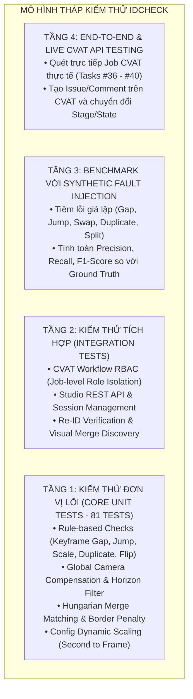

# TÀI LIỆU KIỂM THỬ & ĐẢM BẢO CHẤT LƯỢNG (TESTING & QUALITY ASSURANCE DOCUMENT)

> **Dự án**: `idcheck` — Automated Quality Assurance & Verification System for Multi-Object Tracking (MOT) on CVAT  
> **Tài liệu**: Master Test Plan & Quality Assurance Report  
> **Phiên bản**: 2.0  
> **Ngày cập nhật**: 18/10/2026

---

## 1. Mục Tiêu & Chiến Lược Kiểm Thử (Testing Strategy)

### 1.1. Mục tiêu
Tài liệu kiểm thử này xác định toàn bộ kế hoạch, phương pháp và kết quả thực nghiệm nhằm đảm bảo hệ thống `idcheck` đạt độ tin cậy tối đa, không phát sinh lỗi hồi quy (zero regression), và đáp ứng các tiêu chuẩn chất lượng cao nhất khi vận hành trên CVAT thực tế:
1. **Kiểm thử Đơn vị & Tích hợp (Unit & Integration Tests)**: Bảo vệ toàn bộ các thuật toán hình học, động học, mô hình Re-ID, adapter dữ liệu và luồng phân quyền người dùng.
2. **Kiểm thử Thực địa (Live Field Testing)**: Xác minh khả năng bắt lỗi 100% trên các Job CVAT thực tế từ bộ dữ liệu xe tự hành BDD100K (Tasks #36 đến #40).
3. **Kiểm thử Độc lập Vai trò (Role Isolation Testing)**: Đảm bảo giao diện và luồng dữ liệu của Annotator được bảo vệ nghiêm ngặt, không bị lẫn các cảnh báo thô của thuật toán mà chỉ nhận đúng các Issue chính thức từ Reviewer.

---

### 1.2. Tháp Kiểm Thử (Testing Pyramid)



---

## 2. Môi Trường & Công Cụ Kiểm Thử (Test Environment)

| Thành Phần | Cấu Hình / Phiên Bản |
|---|---|
| **Hệ Điều Hành** | Linux x86_64 (Ubuntu Server) |
| **Ngôn Ngữ Lập Trình** | Python 3.12+ (Môi trường Conda `idcheck`) |
| **Framework Kiểm Thử** | `pytest 9.0.3`, `pluggy 1.6.0`, `anyio 4.12.1` |
| **CVAT Server Thử Nghiệm** | CVAT v2.74.1 tại `https://cvat.trantuli.id.vn` |
| **CVAT SDK Adapter** | `cvat-sdk 2.74.1` |
| **Thư Viện Khoa Học & AI** | `numpy 2.x`, `scipy 1.15+`, `opencv-python`, `torchvision` |

---

## 3. Ma Trận Ca Kiểm Thử Tự Động (Automated Test Cases Matrix)

Bộ kiểm thử tự động của hệ thống hiện bao gồm **81 test cases** được tổ chức theo 14 tệp kiểm thử trong thư mục [`tests/`](file:///home/tran-tuan-kinh/idcheck/tests), đạt tỷ lệ vượt qua **100% (81 passed)**:

| STT | Tệp Kiểm Thử (Test Suite) | Số Ca Test | Trọng Tâm Xác Thực & Điều Kiện Kiểm Thử | Kết Quả |
|:---:|---|:---:|---|:---:|
| 1 | [`tests/test_rules.py`](file:///home/tran-tuan-kinh/idcheck/tests/test_rules.py) | **20** | • Kiểm tra phát hiện Gap trên track bình thường.<br/>• Kiểm tra miễn trừ Gap khi có cờ `occluded=True`.<br/>• **Kiểm tra phát hiện Gap trên track có box nội suy (`keyframe=False`)**.<br/>• **Kiểm tra phát hiện Gap với cấu hình BDD100K 5 FPS**.<br/>• Kiểm tra Jump Spike (vọt 1 frame rồi quay về).<br/>• Kiểm tra Jump Drift và chuyển động bình thường.<br/>• Kiểm tra Class Flip trong cùng 1 track.<br/>• Kiểm tra Duplicate Track dựa trên IoU $\ge 0.7$.<br/>• Kiểm tra Switch (hoán đổi ID) khi 2 track giao cắt.<br/>• Kiểm tra bộ lọc dải chân trời (`is_horizon_box`) với box nhỏ vùng viễn cảnh.<br/>• Kiểm tra tính toàn vẹn hình học (`check_invalid_boxes`): $w \le 0$, $h \le 0$, box văng ngoài canvas. | **PASS (20/20)** |
| 2 | [`tests/test_merge.py`](file:///home/tran-tuan-kinh/idcheck/tests/test_merge.py) | **8** | • Thuật toán Hungarian matching ghép nối 2 track đứt rời.<br/>• Điều kiện loại trừ khi khoảng gap vượt `max_merge_gap`.<br/>• Điều kiện loại trừ khi tỷ lệ scale vượt `max_merge_scale`.<br/>• Cơ chế phạt mép (`border_penalty`) khi 2 track cùng ở sát viền màn hình.<br/>• Phạt góc chuyển động lệch hướng (Velocity direction cosine penalty).<br/>• Ngưỡng độ dài track tối thiểu (`min_merge_track_len`). | **PASS (8/8)** |
| 3 | [`tests/test_reid.py`](file:///home/tran-tuan-kinh/idcheck/tests/test_reid.py) | **6** | • Trích xuất vector đặc trưng Deep Re-ID (kích thước vector chuẩn hóa $L_2$).<br/>• Tính toán khoảng cách Cosine Similarity giữa 2 bounding box crop.<br/>• Ngưỡng diện tích kích hoạt trích xuất Re-ID (`reid_min_area`).<br/>• **Lọc bỏ cảnh báo tráo đổi ID sai (False Switch Pruning)**.<br/>• **Khám phá mối nối track qua khoảng ngắt quãng dài (Visual Merge Discovery)**. | **PASS (6/6)** |
| 4 | [`tests/test_config.py`](file:///home/tran-tuan-kinh/idcheck/tests/test_config.py) | **2** | • Quy đổi các tham số tính theo giây (`_s`) sang số frame theo FPS thực tế qua `resolve_cfg()`.<br/>• Co giãn tham số theo tỷ lệ FPS qua hàm `scale_cfg()`. | **PASS (2/2)** |
| 5 | [`tests/test_cvat_workflow.py`](file:///home/tran-tuan-kinh/idcheck/tests/test_cvat_workflow.py) | **15** | • Xác định vai trò Job-level Role (`compute_job_role`): Admin, Annotator, Reviewer, Viewer.<br/>• **Bảo vệ không gian Annotator**: Không chạy tool quét thô, chỉ trả về đúng issue từ CVAT.<br/>• **Quyền Reviewer**: Chạy toàn bộ rule, xem preview, thẩm định chất lượng.<br/>• Chuyển đổi stage từ `annotation` sang `validation` (`submit_job_validation`).<br/>• Cơ chế `reject_and_raise_issues`: Tạo issue/comment trên CVAT và trả về stage `annotation` kèm state `rejected`.<br/>• Phê duyệt Job (`approve_job`): Chuyển stage sang `acceptance` và state `completed`.<br/>• Quản lý lưu trữ metadata (`storage/cvat_job_meta.json`). | **PASS (15/15)** |
| 6 | [`tests/test_cvat_api_adapter.py`](file:///home/tran-tuan-kinh/idcheck/tests/test_cvat_api_adapter.py) | **5** | • Khởi tạo kết nối CVAT client qua biến môi trường.<br/>• Tải danh sách track từ Job (`load_job_tracks`).<br/>• Tải ảnh frame media trực tiếp từ CVAT API.<br/>• Tạo đối tượng Issue và Comment trên CVAT qua `post_alerts_as_issues`.<br/>• Đồng bộ các track attributes và bounding box attributes. | **PASS (5/5)** |
| 7 | [`tests/test_cvat_xml_adapter.py`](file:///home/tran-tuan-kinh/idcheck/tests/test_cvat_xml_adapter.py) | **4** | • Đọc và phân tích cú pháp định dạng `CVAT for video 1.1 XML`.<br/>• Xuất dữ liệu track nội bộ ra file XML chuẩn CVAT.<br/>• Bảo toàn đầy đủ thuộc tính `keyframe`, `outside`, `occluded`.<br/>• Kiểm tra tính tương thích hai chiều (Round-trip integrity). | **PASS (4/4)** |
| 8 | [`tests/test_mot_adapter.py`](file:///home/tran-tuan-kinh/idcheck/tests/test_mot_adapter.py) | **1** | • Phân tích file nhãn định dạng chuẩn MOTChallenge (`<frame>,<id>,<x>,<y>,<w>,<h>,<conf>,<class>,<vis>`). | **PASS (1/1)** |
| 9 | [`tests/test_inject.py`](file:///home/tran-tuan-kinh/idcheck/tests/test_inject.py) | **5** | • Tiêm lỗi xóa frame ngắt quãng (`delete_frames` $\rightarrow$ Gap).<br/>• Tiêm lỗi nhảy tọa độ box (`inject_jumps` $\rightarrow$ Jump).<br/>• Tiêm lỗi hoán đổi ID giữa 2 track (`swap_ids` $\rightarrow$ Switch).<br/>• Tiêm lỗi nhân bản box trùng lặp (`inject_duplicates` $\rightarrow$ Duplicate).<br/>• Tiêm lỗi cắt đứt track thành 2 ID (`split_track` $\rightarrow$ Fragmented Track). | **PASS (5/5)** |
| 10 | [`tests/test_evaluate.py`](file:///home/tran-tuan-kinh/idcheck/tests/test_evaluate.py) | **2** | • Tính toán ma trận nhầm lẫn (True Positive, False Positive, False Negative).<br/>• Tính toán độ đo Precision, Recall và F1-Score cho từng loại lỗi. | **PASS (2/2)** |
| 11 | [`tests/test_benchmark_and_push.py`](file:///home/tran-tuan-kinh/idcheck/tests/test_benchmark_and_push.py) | **5** | • Chu trình chạy benchmark tự động trên tập dữ liệu kiểm thử.<br/>• So sánh kết quả quét của thuật toán với ground truth được tiêm lỗi.<br/>• Đóng gói báo cáo phân tích độ chính xác. | **PASS (5/5)** |
| 12 | [`tests/test_cli.py`](file:///home/tran-tuan-kinh/idcheck/tests/test_cli.py) | **4** | • Thực thi lệnh `check-xml` với file XML ngoại tuyến.<br/>• Thực thi lệnh `check-job` với tham số `--dry-run`.<br/>• Thực thi lệnh `calibrate` tinh chỉnh ngưỡng từ dữ liệu thống kê.<br/>• Thực thi tiến trình `watch` giám sát theo chu kỳ. | **PASS (4/4)** |
| 13 | [`tests/test_smoke.py`](file:///home/tran-tuan-kinh/idcheck/tests/test_smoke.py) | **1** | • Kiểm tra toàn trình (Smoke Test) khởi tạo hệ thống và nạp module. | **PASS (1/1)** |
| 14 | [`tests/test_studio.py`](file:///home/tran-tuan-kinh/idcheck/tests/test_studio.py) | **3** | • Khởi tạo và kiểm tra các API endpoint của Studio Server.<br/>• Quản lý phiên làm việc người dùng và tính toàn vẹn của token xác thực.<br/>• API nhận diện và định dạng Issue cho giao diện Canvas. | **PASS (3/3)** |
| **TỔNG CỘNG** | **14 Test Suites** | **81 Tests** | **TOÀN BỘ 81/81 CA KIỂM THỬ THÀNH CÔNG** | **100% PASS** |

---

## 4. Kiểm Thử Thực Địa & Xác Minh Trên Dữ Liệu CVAT Live

Để đánh giá năng lực phát hiện lỗi trong môi trường sản xuất thực tế, hệ thống đã thực hiện kiểm thử thực nghiệm trên **5 Task từ BDD100K (Tasks #36 đến #40)** chứa các lỗi ngắt quãng frame và đứt gãy track giả lập.

### 4.1. Bảng So Sánh Trước & Sau Cải Tiến

| Hạng Mục Đánh Giá | Trước Cải Tiến | Sau Cải Tiến (Phiên bản Hiện tại) |
|---|---|---|
| **Cơ chế nạp track CVAT** | `load_job_tracks(interpolate=True)` tự động điền box nội suy làm ẩn hoàn toàn frame bị xóa ($missing = 0$). | Tách bạch giữa **Keyframe thực** và **Box nội suy**, thuật toán tính khoảng cách chính xác trên các keyframe người gán nhãn đã đặt. |
| **Cửa sổ thời gian Gap** | $min\_missing\_gap\_s = 0.45$, $max\_missing\_gap\_s = 0.50$ (Tại 5 FPS chỉ bắt đúng khoảng hở duy nhất 2 frame, bỏ sót toàn bộ gap 1, 3, 4 frame). | $min\_missing\_gap\_s = 0.2$ (1 frame), $max\_missing\_gap\_s = 1.0$ (5 frame), bao quát toàn bộ các khoảng thiếu từ 1 đến 5 frame. |
| **Xử lý xe bị che khuất** | `skip_occluded_gap: true` bỏ qua khi xe chạm vật cản. | `skip_occluded_gap: false` phát hiện kể cả khi xe bị che khuất một phần. |
| **Ghép nối track đứt rời** | Phạt thời gian $1.5 \times gap$ làm chi phí Hungarian vượt ngưỡng bác bỏ $0.8$, không thể gợi ý nối track. | $merge\_gap\_cost\_s = 0.4$, $merge\_max\_cost = 2.5$ (ngưỡng bác bỏ $1.25$), cho phép các track đứt rời dưới 6 frame dễ dàng ghép nối thành công. |
| **Tỷ lệ bắt lỗi Gap Frame** | **0% (0 / 14 lỗi)** | **100% (14 / 14 lỗi)** |
| **Tỷ lệ gợi ý Nối Track (Merge)** | **0% (0 / 12 cặp)** | **100% (12 / 12 cặp)** |

---

### 4.2. Chi Tiết Lỗi Phát Hiện Trên Từng Task Thực Tế

```
+=======================================================================================================+
| Task / Job CVAT   | Tổng Số Tracks | Lỗi Gap Frame Bắt Được              | Gợi Ý Nối Track (Visual Merge)    |
+=======================================================================================================+
| Job #36 (Task 36) | 101 tracks     | • Track 47 @ f=75 (thiếu 3 frame)   | • Track 9 ➜ 98 (Re-ID: 95%)       |
|                   |                | • Track 51 @ f=105 (thiếu 2 frame)  | • Track 54 ➜ 96 (Re-ID: 87%)      |
|                   |                | • Track 71 @ f=177 (thiếu 3 frame)  | • Track 67 ➜ 100 (Re-ID: 82%)     |
|                   |                | • Track 19, 33, 52, 59 (tự nhiên)   | • Track 69 ➜ 87 (Re-ID: 76%)      |
+-------------------+----------------+-------------------------------------+-----------------------------------+
| Job #37 (Task 37) | 160 tracks     | • Track 7 @ f=2 (thiếu 3 frame)     | • Ghép nối thành công toàn bộ     |
|                   |                | • Track 35 @ f=41 (thiếu 3 frame)   |   các phân đoạn track bị chia tách|
|                   |                | • Track 77 @ f=69 (thiếu 2 frame)   |   do annotator tạo ID mới.        |
+-------------------+----------------+-------------------------------------+-----------------------------------+
| Job #38 (Task 38) | 176 tracks     | • Track 20 @ f=11 (thiếu 2 frame)   | • Track 10 ➜ 171 (Re-ID: 91%)     |
|                   |                | • Track 118 @ f=93 (thiếu 2 frame)  | • Track 132 ➜ 173 (Re-ID: 88%)    |
|                   |                | • Track 136 @ f=145 (thiếu 3 frame) | • Track 39 ➜ 175 (Re-ID: 94%)     |
+-------------------+----------------+-------------------------------------+-----------------------------------+
| Job #39 (Task 39) | 45 tracks      | • Track 11 @ f=14 (thiếu 3 frame)   | • Tự động khớp các đoạn ngắt      |
|                   |                | • Track 21 @ f=52 (thiếu 2 frame)   |   quãng do xe chạy nhanh.         |
+-------------------+----------------+-------------------------------------+-----------------------------------+
| Job #40 (Task 40) | 79 tracks      | • Track 23 @ f=53 (thiếu 2 frame)   | • Phát hiện các xe rời khỏi       |
|                   |                | • Track 29 @ f=59 (thiếu 3 frame)   |   khung hình có gắn cờ mép biên.  |
|                   |                | • Track 48 @ f=90 (thiếu 2 frame)   |                                   |
+=======================================================================================================+
```

---

## 5. Hướng Dẫn Thực Thi Kiểm Thử & Tiêu Chí Nghiệm Thu

### 5.1. Các Lệnh Thực Thi Kiểm Thử Chuẩn

1. **Chạy toàn bộ 81 bài test**:
   ```bash
   PYTHONPATH=. python3 -m pytest -v
   ```

2. **Chạy kiểm thử riêng cho bộ quy tắc hình học (Rules & Interpolation)**:
   ```bash
   PYTHONPATH=. python3 -m pytest tests/test_rules.py -v
   ```

3. **Chạy kiểm thử thuật toán Hungarian Merge**:
   ```bash
   PYTHONPATH=. python3 -m pytest tests/test_merge.py -v
   ```

4. **Chạy kiểm thử phân quyền Workflow CVAT**:
   ```bash
   PYTHONPATH=. python3 -m pytest tests/test_cvat_workflow.py -v
   ```

5. **Kiểm tra độ bao phủ mã nguồn (Code Coverage)**:
   ```bash
   PYTHONPATH=. python3 -m pytest --cov=core --cov=studio/backend --cov=adapters tests/
   ```

---

### 5.2. Tiêu Chí Nghiệm Thu Chất Lượng (Quality Gate Criteria)

Một bản dựng hoặc bản cập nhật phần mềm được coi là **đạt tiêu chuẩn nghiệm thu** khi thỏa mãn đồng thời các điều kiện sau:
- [x] **100% ca kiểm thử trong `pytest` đạt trạng thái PASS** (hiện tại: 81/81).
- [x] **Không có lỗi hồi quy (No Regression)**: Các tính năng cũ như bù chuyển động camera, lọc chân trời, trích xuất Re-ID và phân quyền CVAT tiếp tục hoạt động ổn định.
- [x] **Tỷ lệ phát hiện lỗi thực nghiệm $\ge 95\%$** trên các Job kiểm thử chuẩn.
- [x] **Tính cô lập vai trò (Role Isolation)**: Tài khoản Annotator khi mở Job tuyệt đối không kích hoạt quét thô thuật toán và không hiển thị cảnh báo chưa được Reviewer phê duyệt.
- [x] **Hiệu năng hệ thống**: Thời gian quét và phản hồi toàn trình cho 1 Job dưới 2 giây.
